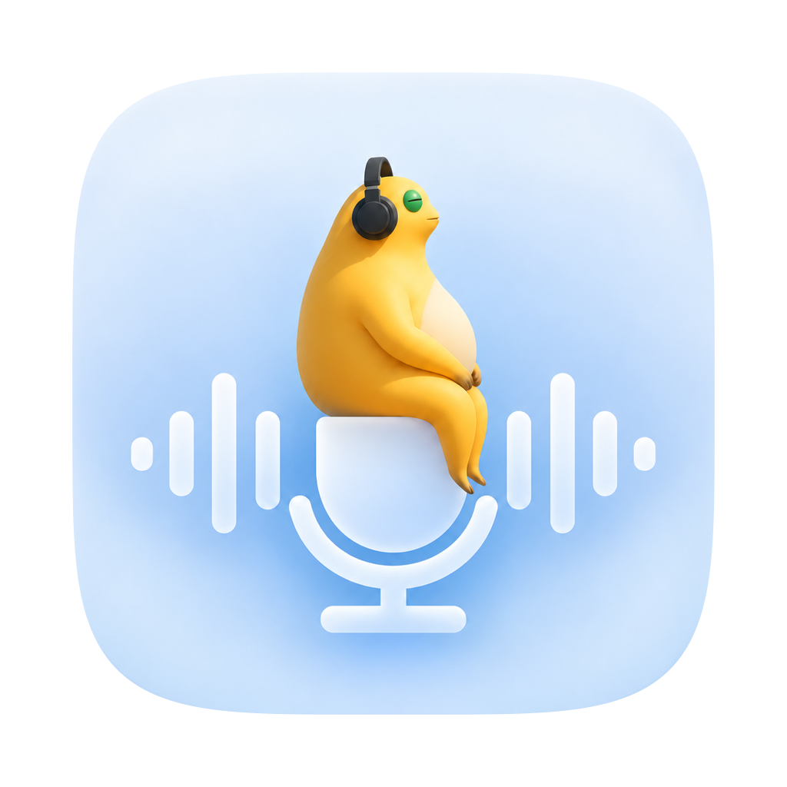

<p align="center">
  
</p>

<h1 align="center">轻录</h1>

<p align="center">简单、专注的 Mac 录音工具。</p>

<p align="center">
  <a href="https://github.com/Sinclair2003/light-recorder/releases/latest">下载最新版</a> · macOS 15+ · Apple Silicon
</p>

## 功能

- **自由选择声源**：系统声音、麦克风，或同时录制。
- **灵活控制**：暂停、继续，录制中切换来源和麦克风。
- **录完即用**：保存为一个 M4A 文件，内置列表、播放器和删除功能。
- **安心留在本地**：无需账号或额外驱动；关闭窗口后，菜单栏继续录音。

## 开始使用

1. [下载安装包](https://github.com/Sinclair2003/light-recorder/releases/latest/download/LightRecorder-macOS-arm64.zip)，解压后将「轻录」拖入“应用程序”。
2. 打开应用，选择录音来源，按提示授予相应权限。
3. 点击「开始录音」，完成后点击「结束并保存」。

录音只保存在本机，可自行选择保存位置。双路录音建议戴耳机；设备切换可能短暂静音，录制时请勿合盖或主动睡眠。

> 当前安装包为本地签名版本，尚未通过 Apple 公证，首次打开可能出现系统安全提示。

## 从源码构建

安装 Apple Command Line Tools 后，在项目目录运行：

```sh
./scripts/install.sh
```

[测试与验收](docs/TESTING.md) · [反馈问题](https://github.com/Sinclair2003/light-recorder/issues)
